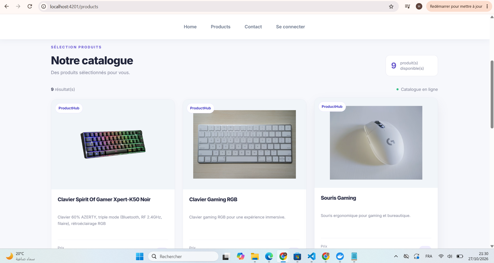
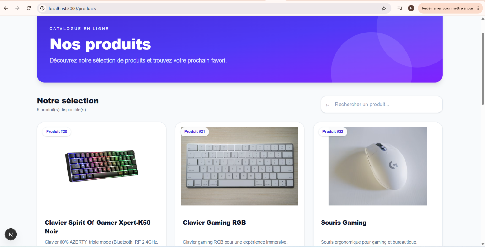
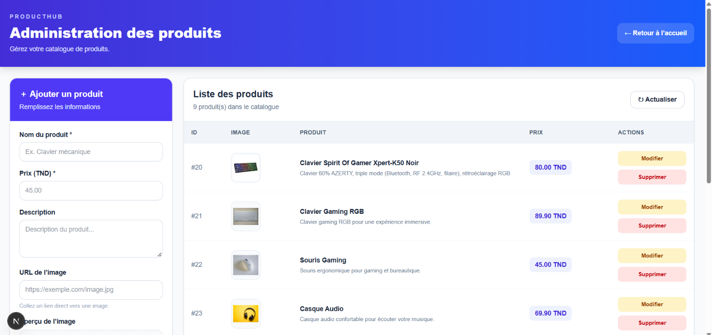
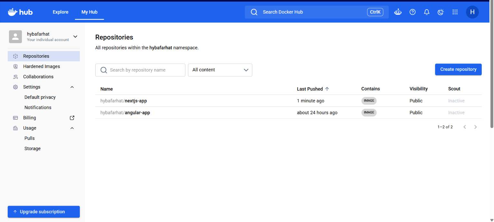
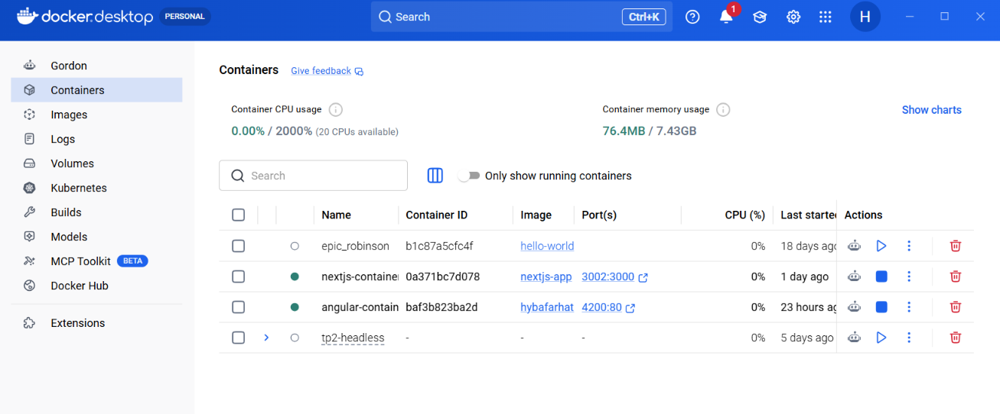

\# Full Stack Web Application


Projet réalisé dans le cadre des travaux pratiques de développement Full Stack.


\## Présentation


Ce projet regroupe plusieurs applications permettant de découvrir la création d'une application web complète, depuis l'interface utilisateur jusqu'à l'API et la base de données.


\## Technologies utilisées


\- \*\*Angular\*\* : application frontend `ngapp`

\- \*\*Next.js\*\* : application frontend `nxapp`

\- \*\*Node.js et Express\*\* : API backend

\- \*\*PostgreSQL / Prisma\*\* : gestion des données

\- \*\*Git et GitHub\*\* : gestion du code source


\## Structure du projet


```text

fullstack-tp/

├── ngapp/                 # Application Angular

├── nxapp/                 # Application Next.js

├── api/                   # API backend

├── backend/               # Backend complémentaire

├── docs/

│   └── screenshots/       # Captures d'écran

└── README.md

```


## Captures d'écran

### 1. Application Angular



### 2. Application Next.js



### 3. Interface de gestion des produits


### 4. Docker Hub — Images publiées



### 5. Docker Desktop — Conteneurs




> Remplacez ces images par les captures d'écran réelles de vos applications.


\## Installation et lancement


Les commandes de lancement dépendent de l'application utilisée et de sa configuration.


\### Angular


```bash

cd ngapp

npm install

ng serve

```


\### Next.js


```bash

cd nxapp

npm install

npm run dev

```


\### API backend


Consultez le fichier `package.json` du dossier `api` pour connaître les scripts disponibles et les paramètres nécessaires à son démarrage.


\## Auteur


hyba farhat


